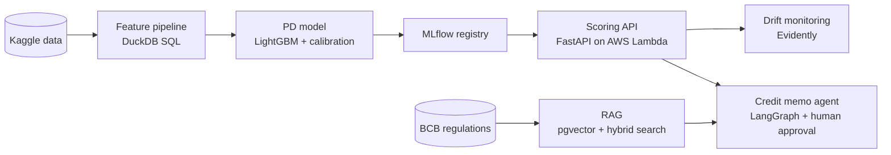

# Credit Copilot

[](https://github.com/mamedevitor/credit-copilot/actions/workflows/ci.yml)

Credit decisions need more than a score: an analyst has to turn it into a memo that explains the drivers and cites the regulation. Credit Copilot scores loan applications with a calibrated probability-of-default (PD) model served as an API and monitored for drift, then uses an LLM agent with retrieval over Brazilian Central Bank rules (CMN Resolution 4,966) to draft the credit memo for a human to approve.

> **Status:** work in progress. Phase 0 (foundations) is done; Phase 1 (PD model) is next.

## Architecture

Planned design. Each block is filled in as its phase is built.



## Roadmap

| Phase | Scope | Status |
| --- | --- | --- |
| 0 | Repo foundations: uv, ruff, pytest, Docker Compose, Makefile, CI | ✅ |
| 1 | PD model: out-of-time validation, logistic baseline, LightGBM, calibration, SHAP, fairness, model card | ⏳ |
| 2 | Production scoring: FastAPI, Docker, AWS Lambda, drift monitoring, retraining trigger | |
| 3 | RAG over BCB regulations: hybrid search, golden-set evaluation | |
| 4 | Credit memo agent: LangGraph, human-in-the-loop, guardrails, tracing | |

## Results

Filled in as each phase lands.

| Area | Metric | Result |
| --- | --- | --- |
| PD model | Gini, out-of-time | — |
| PD model | Stability metric (competition) | — |
| PD model | Brier score, after calibration | — |
| Scoring API | p95 latency | — |
| RAG | Recall@5 / MRR | — |
| Agent | Cost per memo | — |

## Quickstart

Requirements: [uv](https://docs.astral.sh/uv/), Docker (Docker Desktop or OrbStack), and the [Kaggle CLI](https://github.com/Kaggle/kaggle-api) logged in to an account that has accepted the [competition rules](https://www.kaggle.com/competitions/home-credit-credit-risk-model-stability/rules).

```bash
git clone https://github.com/mamedevitor/credit-copilot.git
cd credit-copilot
make install            # create .venv from uv.lock
cp .env.example .env    # then set your own password
make up                 # Postgres (pgvector) and MLflow at http://localhost:5001
make data               # download the training data (~1.2 GB)
make check              # lint and tests, same as CI
```

Run `make help` to list every task.

## Data

[Home Credit – Credit Risk Model Stability](https://www.kaggle.com/competitions/home-credit-credit-risk-model-stability) (Kaggle, 2024): about 1.5 million loan applications with a week index, which allows out-of-time validation and shows real drift. The data is not redistributed here. `make data` downloads it with your own Kaggle account, and [`scripts/data_manifest.csv`](scripts/data_manifest.csv) lists the expected files and sizes.

## Repository layout

```
src/credit_copilot/   Python package: data, features, models, api, rag, agent
notebooks/            analysis and experiments
scripts/              data download and other one-off tasks
tests/                pytest suite
docker/               images and init scripts for Docker Compose
```
